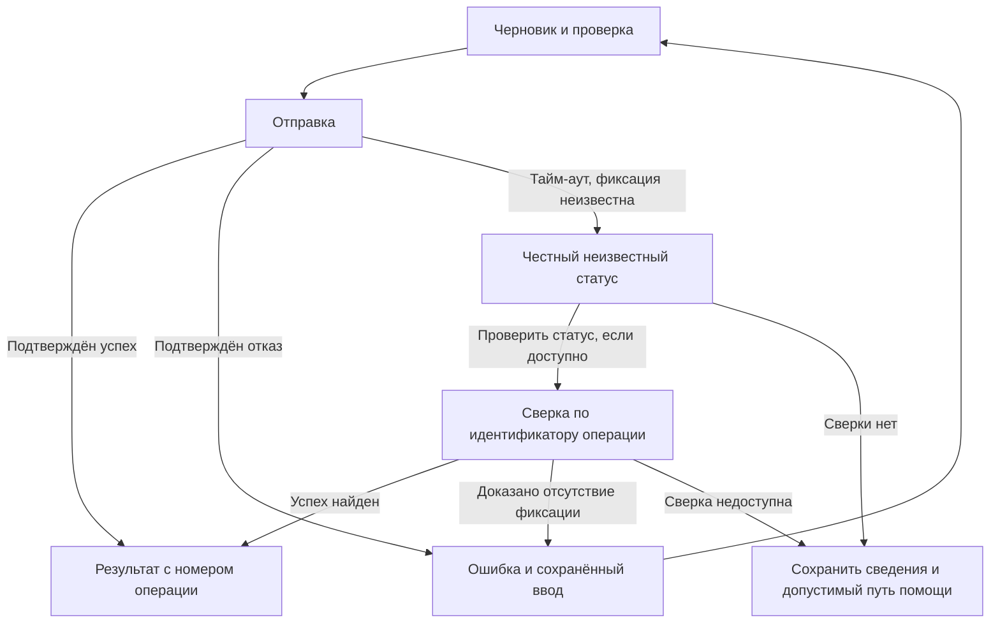

# Весь сценарий и усилие в точках контакта

Глубиной анализа, проверки и отчёта владеет раздел «Выбрать достаточную глубину» в [SKILL.md](../SKILL.md#выбрать-достаточную-глубину).
Читай нужные разделы при анализе или изменении последовательности действий либо целого процесса, а не из-за самого наличия формы или навигации.
Ссылки на принципы не требуют полного аудита соседних разделов.
Применяй правила целевой среды по общему разделу «Применимость и платформа» в [principles.md](principles.md#применимость-и-платформа).

## Единицы анализа

Это наша модель анализа, а не универсальный стандарт измерения.
Связь нужных каналов и результат за пределами одной службы опираются на `GOV-WHOLE` и `GOV-CHANNEL`.
Разделение усилий опирается на `NNG-COST`.

| Единица | Что считать | Что не смешивать |
|---|---|---|
| Точка контакта с сервисом | Эпизод взаимодействия через канал: письмо, визит в портал, звонок | Каждый клик внутри эпизода не становится новой точкой контакта |
| Действие в интерфейсе | Нажатие, выбор, ввод, прокрутка по заранее заданной методике | Одно нажатие может требовать сложного решения |
| Решение | Выбор, который требует оценки альтернатив | Автоматическое нажатие знакомой кнопки |
| Повторный ввод | Повтор уже сообщённых сведений | Законное уточнение изменившихся данных |
| Передача/переключение | Смена ответственного, канала, приложения или рабочего контекста | Нужная передача не всегда является дефектом |
| Ожидание | Время без возможности продвинуть задачу | Время осмысленного чтения или проверки |

Задай границу эпизода до подсчёта и используй её одинаково в вариантах.
Не складывай секунды, клики и решения в общий «балл UX».
Отличай измеренное значение от оценки, диапазона и неизвестного.
Для изменения всего процесса итоговое сравнение до/после содержит отдельные строки для всех шести единиц выше: контактов, действий, решений, повторного ввода, переключений и ожидания.
Компактной таблицы достаточно; не заполняй пробелы придуманными числами.
Если известно только наличие повторного ввода, запиши «есть, количество неизвестно».
Если неизвестна и сама нагрузка, запиши «неизвестно» и способ наблюдения.
Для локального изменения компонента проверь только затронутый путь, без полного реестра сервиса.
Для измерений указывай участников, задачу, метод и ограничения выборки.

## Контракт сценария

Заполни только применимые поля, сохраняя важные риски:

- **Пользователь:** роль, опыт и ограничения.
- **Цель и триггер:** какое событие запускает работу и какой результат нужен.
- **Контекст:** устройство, канал, среда, частота, прерывания, доступность и поддерживаемая локаль. Язык и форматы — UX-09; восприятие — UX-25.
- **Риск:** цена ошибки, приватность, обратимость, ограничения полномочий.
- **Предусловия:** права, доступные данные, соединение, внешние зависимости.
- **Основной путь:** действия пользователя и ответы системы до узнаваемого результата. Если работа включает повторяющиеся циклы изменения, наблюдения и сравнения или параллельные контексты, учитывай их и отмечай промежуточные результаты (`EVM-DEVTOOLS`, `VSCODE-LAYOUT`). Не подгоняй такой путь под линейную последовательность. Локальная правка не требует полного графа. Применимые возврат и отмена — UX-10/28, ограничения времени — UX-03. Ввод — UX-06/21; доступный компонент и фокус — UX-14/23.
- **Узнаваемый успех:** подтверждённый итог, следующий шаг и возвращение к подтверждению по UX-01. Критерий результата и признаки ухудшения выбери по UX-05.
- **Отклонения:** применимые загрузка, частичные/устаревшие данные, отсутствие сети, пустые данные, отсутствие результатов и запрет — UX-04; ошибка — UX-21, неизвестная фиксация — UX-20, тайм-аут и продолжение — UX-03/19.

Выяви неизвестное в доступных материалах.
Не выдумывай пользователя и не превращай отсутствие исследования в скрытую уверенность.
Если проверка гипотезы нужна в выбранном объёме и разрешена, предпочти дешёвую обратимую проверку на реальной задаче.
При явном запрете испытаний соблюдай его и назови предел доказательств по SKILL.md; не объявляй гипотезу проверенной.

## Реестр контактов: вымышленный пример B2B-операции

Это иллюстрация, не наблюдение в существующем продукте.
Сценарий: опытный диспетчер получает заявку на перевозку и прикрепляет документы к нужному отправлению в рабочем веб-портале.
Успех: портал показывает подтверждённый номер операции, правильное отправление и принятый комплект документов.
Получение письма не доказывает завершение серверной операции.

Предусловия: пользователь вошёл, имеет нужные права, располагает документами.
Риски: неверное отправление, дубликат отправки, чужие документы.
Файлы остаются в разрешённых границах; новую интеграцию электронной почты пример не разрешает.

**До — пять предполагаемых эпизодов контакта:**

| ID | Контакт / необходимость | Владелец следующего шага | Сохранённая информация | Нагрузка |
|---|---|---|---|---|
| J-B1 | Письмо с заявкой / необходимо получить основание | Диспетчер | Номер и документы только в письме | Чтение, решение |
| J-B2 | Портал: первоначальный ввод / необходима фиксация | Портал | Поля до ошибки не сохранены | Повторный ввод, выбор файла |
| J-B3 | Письмо коллеге: уточнение обязательного поля / устранимо, если данные уже доступны | Коллега | Ответ в отдельной ветке | Переключение, ожидание |
| J-B4 | Повторный визит в портал / вызван потерей формы | Диспетчер | Повторно набранные поля | Повторный ввод, проверка |
| J-B5 | Письмо о статусе / полезный канал наблюдения | Портал | Номер операции | Чтение статуса |

**После — три предполагаемых эпизода контакта:**

| ID | Контакт / необходимость | Владелец следующего шага | Сохранённая информация | Нагрузка |
|---|---|---|---|---|
| J-A1 | Письмо с заявкой / сохранено | Диспетчер | Номер и исходные документы | Чтение |
| J-A2 | Портал: найденное отправление, черновик, проверка, фиксация / сохранено | Портал | Известные поля, черновик, номер операции | Выбор, необходимая проверка, ожидание |
| J-A3 | Письмо о подтверждённом статусе / сохранено | Портал | Номер и ссылка на результат | Чтение статуса |

Переход к локальному файлу — переключение контекста, но не отдельный контакт с сервисом.
Передача на обязательное независимое согласование, если она нужна по регламенту, остаётся в обоих вариантах.
Нельзя удалить её ради красивых счётчиков.

| Показатель | До, оценка | После, оценка | Как проверить |
|---|---:|---:|---|
| Точки контакта | 5 | 3 | Проследить эпизоды по журналу сценария |
| Действия в интерфейсе | 18 | 14 | Одинаковый протокол подсчёта на записи выполнения |
| Решения | 6 | 4 | Наблюдать остановки и объяснения пользователя |
| Повторный ввод полей | 4 | 0 | Сравнить поля и причины повторов |
| Переключения контекста | 6 | 2 | Записать переходы между каналами и приложениями |
| Блокирующие ожидания | 2 | 1 | Измерить длительность каждого; числа не доказывают экономию времени |
| Успешность, время, ошибки | Не измерены | Не измерены | Сопоставимые реальные задания; до теста эффект неизвестен |
| Восстановление | Потеря формы | Черновик + сверка статуса | Прервать путь и вернуться; пока не проверено |

**Ловушка меньшего числа кликов.** Вариант из восьми действий убирает просмотр выбранного отправления и принуждает вспоминать номер из письма.
Число действий меньше, но пользователь теряет проверку и переносит сведения в памяти.
Не объявляй его лучшим без сравнения ошибок и успешности.
Вариант из четырнадцати действий сохраняет необходимую проверку.
Ни один вариант ещё не доказан этим примером.

## Восстановление после отправки

Диаграмма — собственная логика сценария.
Она не доказывает реализацию идемпотентности или серверной сверки.
`STRIPE-ERRORS` объясняет неопределённый исход и ограничения безопасного повтора; названия действий и путь помощи ниже — наш синтез.
Кнопка сверки называется «Проверить статус», а не «Повторить» с мелким пояснением.
Доступное имя кнопки и её фактическое действие должны совпадать.
Если сверки нет или она временно недоступна, не показывай неработающую основную кнопку.
Сохрани идентификатор исходной операции и допустимый контекст; предложи «Сохранить сведения» и доступный контакт поддержки либо другой реальный путь сверки.
Пользователь может завершить текущий сеанс с сохранённым неизвестным статусом без новой отправки.
Не обещай автоматическую сверку или поддержку, которых нет; обозначь зависимость.
Повтор запроса исходной операции допустим только при проверенных гарантиях конкретной системы, с тем же идентификатором и параметрами в пределах её срока защиты от дубликатов.
Это не новая операция; без этих гарантий неизвестный исход требует сверки, а не новой отправки.

| Отклонение | Ожидаемое поведение |
|---|---|
| Нет сети до отправки | Черновик безопасно сохранён; нет ложного «отправлено» |
| Тайм-аут после отправки | Неизвестность видна; «Проверить статус» сверяет исходную операцию. Без сверки доступны сохранение сведений и реальный путь помощи без новой отправки |
| Отказ доступа | Нет ложного пустого списка; виден допустимый путь обращения |
| Нет документов / нет совпадений поиска | Разные объяснения и разные следующие действия |
| Ошибка одного файла | Остальные результаты видны; исправление не сбрасывает весь ввод |
| Прерывание и возврат | Видны сохранённый шаг, актуальность и оставшаяся работа |

## Запись приёмки

Порядок, глубину и пределы приёмки определяет пункт 6 [SKILL.md](../SKILL.md). Используй только применимые строки шаблона; он не требует новых состояний или сценариев.

| Сценарий / среда | Шаги | Ожидаемый результат | Наблюдаемый результат | Исход | Свидетельство |
|---|---|---|---|---|---|
| Основной путь | Конкретные действия | Узнаваемый успех | Только фактическое наблюдение | Пройден / не пройден / не проверен | Снимок, запись, журнал без личных данных |
| Прерывание / ошибка | Причина и момент | Сохранение и восстановление | Фактическое наблюдение | То же | То же |
| Клавиатура / доступность | Путь, фокус, масштаб и нужные средства | Работа без недоступного контрола | Фактическое наблюдение | То же | Снимок и описание проверки |

Снимок подтверждает состояние; для перехода, когда снимка недостаточно, нужна запись или журнал без личных данных. Для применимой проверки доступности укажи порядок и видимость фокуса, достижимость действий и отсутствие ловушки. Укажи нужное средство платформы и наблюдение, например объявление ошибки или смены статуса программой чтения с экрана. Без наблюдения результат остаётся «не проверен».
